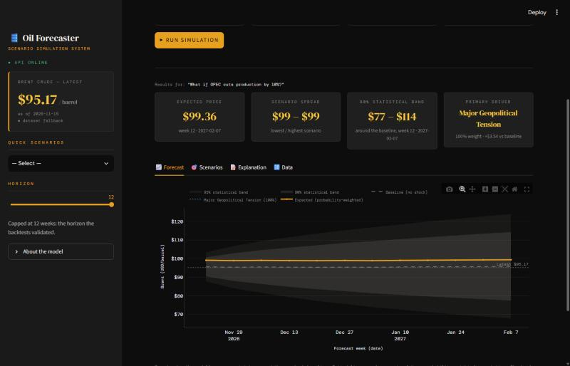
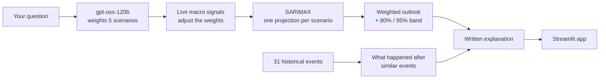
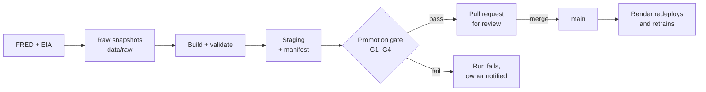

# 🛢️ Crude Oil Scenario Forecaster

**Ask a "what if" question about the oil market in plain English. Get a probability-weighted
Brent price outlook, an honest uncertainty range, and what actually happened after similar
events in the past.**

[](https://crude-forecaster.streamlit.app/)
[](https://crudeoil-forecaster.onrender.com/docs)
[](https://github.com/Jaywestty/CrudeOil-Forecaster/actions/workflows/ci.yml)



> The live API runs on Render's free tier: the first request after 15 idle minutes takes
> 30–60 seconds while it wakes up.

---

## Contents

- [In one minute](#in-one-minute) — for everyone
- [Highlights](#highlights) — what was built and what it demonstrates
- [What the evaluation found](#what-the-evaluation-found)
- [How it works](#how-it-works)
- [For ML engineers: methodology](#for-ml-engineers-methodology)
- [Data pipeline and MLOps](#data-pipeline-and-mlops)
- [Run it yourself](#run-it-yourself) · [API](#api) · [Project structure](#project-structure)
- [Design decisions and trade-offs](#design-decisions-and-trade-offs) · [Limitations](#limitations-and-next-steps)

---

## In one minute

**What it does.** You type a question such as *"What if Middle East tensions rise while
demand also grows?"*. The app:

1. uses a language model to decide how much each of five standard scenarios (OPEC cut,
   geopolitical tension, demand boom, recession, Fed rate hike) applies to your question;
2. adjusts those weights using current market signals (volatility, the dollar, inventories);
3. projects Brent crude 4–12 weeks ahead under each scenario and combines them;
4. shows a statistical range, what happened after comparable real events, and a written
   explanation.

**What it is not.** It is not a price predictor. The project tested that question properly:
across four years of weekly forecasts made the way they would have been made in real time,
no model, including this one, beat simply assuming *"the price stays where it is."* Oil
prices a few weeks out are close to unpredictable from public data, which matches the
research literature.

**Why it's still useful.** It is a **scenario tool**: it compares *what-ifs* against a
no-shock baseline, says how wide the uncertainty really is, and shows the range of what
happened historically after similar events, clearly labelled as history rather than a forecast.

<details>
<summary><b>Key terms in plain English</b></summary>

| Term | Meaning |
|---|---|
| **Backtest** | Replaying history: make a forecast using only what was known on a past date, then check it against what happened. |
| **Naive / no-change forecast** | "Next week's price equals today's." The simplest benchmark, and a hard one to beat for market prices. |
| **Leakage** | Accidentally letting a model see information it would not have had at the time. It makes results look better than they are. |
| **Calibration** | Whether a "95% range" really contains the outcome about 95% of the time. |
| **Scenario spread vs statistical band** | The spread is how far apart the what-ifs land. The band is the model's own uncertainty around the no-shock path. |

</details>

---

## Highlights

**What this project demonstrates** (each item links to code or a generated report):

- **Honest evaluation.** A walk-forward backtest over 198 weekly forecast dates with leakage
  guards proven by tests, baselines, Diebold–Mariano significance tests and Holm correction
  for multiple comparisons ([report](reports/backtest/report.md)).
- **Rules fixed before results.** Every experiment states its decision rule before running,
  and the rule is followed even when the result is disappointing.
- **Uncertainty that is checked, not assumed.** Interval coverage measured by regime, plus
  split, adaptive and volatility-scaled conformal prediction ([report](reports/calibration/report.md)).
- **An event study.** 31 dated historical events used to test whether "what happened last
  time" forecasts the next time ([report](reports/scenarios/report.md)).
- **A reproducible data pipeline.** Raw-data snapshots, pure build functions, validation, a
  promotion gate with recorded human overrides, and a model registry with lineage and
  rollback ([pipeline/](pipeline)).
- **Automation with a human in the loop.** CI on every push, and a weekly job that fetches
  new data, runs the gate and opens a pull request for review ([workflows](.github/workflows)).
- **A production LLM integration.** `gpt-oss-120b` on Groq, with token budgeting for a
  reasoning model, graceful fallbacks, and guardrails so the model presents history as
  history.
- **Debugging in production.** A 488 MB model file crashed the 512 MB server. Keeping only
  the model's final state cut it to 2.8 MB with identical forecasts.
- **140 automated tests** covering the API, engine, LLM layer, evaluation and pipeline.

**Tech stack:** Python 3.11 · statsmodels (SARIMAX) · scikit-learn · pandas · FastAPI ·
Streamlit · Plotly · Groq (gpt-oss-120b) · FRED and EIA data · GitHub Actions · Render.

---

## What the evaluation found

| Question | Finding |
|---|---|
| Does the forecasting model beat "no change"? | **No.** In the 2022–25 test, at 1, 4 and 12 weeks its error is 1–5% *higher* than the naive forecast (the gap is not statistically significant). |
| Do stronger models help? | **No.** A regularised linear model and gradient-boosted trees also failed to beat it. The more flexible the model, the worse it did. |
| Why don't the macro variables help? | The dollar–oil weekly correlation fell from **−0.39** (2006–21) to **−0.06** (2022–25). The relationship the model learned broke. |
| Was the original accuracy claim right? | **No.** The original 15.22% error came from one forecast that was given the *actual future* macro data. A flat line scored 12.39% on the same weeks. |
| Are the uncertainty ranges trustworthy? | **On average, yes** (95% bands covered ~85% at 1 week, ~92% at 4, ~97% at 12). **In the 2022 crisis, no** (~71–85%). |
| Does history predict what happens after an event? | **No.** After 9 geopolitical shocks, Brent moved anywhere from **−63% to +17%** in 12 weeks; the median was near zero. |
| Did a data-timing leak matter? | Monthly data was dated before it was published. Fixing it changed accuracy by only ~1%, but revealed the deployed model is **significantly worse than no-change at 12 weeks** (Holm p = 0.038). |
| How does the live model do on unseen data? | On the 45 weeks added in November 2026: one-week error **$8.27 vs $8.29** for no-change. Still no edge. |

**The takeaway:** the project's value is not a clever price prediction. It is a scenario tool
built on an evaluation that tells the truth about what can and cannot be predicted.

---

## How it works



1. **Scenario weights.** The language model reads the question and spreads probability over
   five scenarios. If it is unavailable, a safe default is used instead of failing.
2. **Market adjustment.** Current VIX level, dollar trend, inventory change and Fed policy
   nudge the weights, which are then renormalised.
3. **Projection.** One SARIMAX model, refit whenever new data is promoted, projects Brent under each
   scenario's macro shock. Forecasts start from the latest complete week of data.
4. **Combination.** Scenario paths are averaged by weight. The UI shows the expected path,
   the spread across scenarios, and the model's own 80% and 95% statistical band.
5. **History and explanation.** The app shows the range of Brent moves after comparable real
   events, and the language model writes an explanation that uses only the computed numbers.

---

## For ML engineers: methodology

Each step below has its own reproducible script and generated report.

### 1. Walk-forward evaluation ([report](reports/backtest/report.md))
- **Design:** expanding window, 198 weekly origins (Jan 2022 – Oct 2025), horizons 1–12
  weeks, yearly re-estimation with Kalman-filter updates in between.
- **Leakage guards:** forecasters receive read-only history up to the origin; future
  exogenous values go only to models explicitly flagged as oracles. Tests enforce both.
- **Baselines:** naive, seasonal naive, drift. Metrics: MAE, RMSE, MAPE, MASE, MAE relative
  to naive, directional accuracy, interval coverage.
- **Significance:** Diebold–Mariano with the Harvey–Leybourne–Newbold correction; Holm
  adjustment across every model × horizon test.

| MAE relative to naive (< 1 = better) | 1 week | 4 weeks | 12 weeks |
|---|---|---|---|
| SARIMAX (as deployed) | 1.012 | 1.024 | 1.045 |
| Plain SARIMA | 1.009 | 1.020 | 1.039 |
| Ridge, lagged features | 1.015 | 1.044 | 0.998 |
| Gradient-boosted quantile trees | 1.003 | 1.117 | 1.273 |

### 2. Challengers ([features](evaluation/features.py), [models](evaluation/forecasters.py))
Direct multi-horizon models on lagged features only, with time-series CV using `gap=h` so
overlapping labels cannot leak. A **positive control** (a synthetic series with a real
signal) proves the pipeline can find signal when it exists, so the null result is credible.

### 3. Calibration ([report](reports/calibration/report.md))
Coverage with Newey–West standard errors (overlapping forecasts are correlated), the
interval score as the selection criterion, and coverage split by regime. Conformal methods
were dominated by the 2020 crash for as long as it stayed in the calibration window;
volatility scaling fixed short horizons but blew up at 12 weeks.

### 4. Scenario calibration ([report](reports/scenarios/report.md))
A leave-one-event-out event study on 31 dated events, with confounded events flagged in
advance and a sensitivity analysis. Historical medians forecast worse than both the current
engine and no-change (12-week MAE 0.216 vs 0.191 vs 0.188), so history is shown only as
labelled context.

### 5. Data timing ([report](reports/data/recipe_comparison.md))
Monthly series are shifted to their publication dates (`v2-release-aware` recipe) and
partial final weeks are dropped. The change was adopted on principle before measuring it.

---

## Data pipeline and MLOps



- **Sources:** FRED's public CSV endpoint (Brent, industrial production, dollar index, fed
  funds, VIX) and the EIA API (US crude stocks including the SPR), with retries and backoff.
- **Reproducibility:** builds read only raw snapshots. Rebuilding the original notebook
  dataset matches it exactly except for documented differences (source revisions and a partial final week)
  ([report](reports/data/reproduction.md)).
- **Validation:** gaps, missing values, implausible levels and internal consistency block a
  build; extreme moves and stale data are flagged for review.
- **Promotion gate** ([`pipeline/promote.py`](pipeline/promote.py)):

  | Gate | Check |
  |---|---|
  | G1 data | Validation passed and the production recipe was used |
  | G2 continuity | No dates removed; at most 5% of rows revised per column (otherwise a human reviews) |
  | G3 fit | The refit converged with finite parameters |
  | G4 sanity | The 12-week forecast and band are finite and within 0.5×–2× the last price |

  Only G2 can be overridden, and only with a written reason. Promotions are written
  atomically, and identical data is never promoted twice.
- **Registry:** [`models/registry.json`](models/registry.json) records data hashes, fit summary,
  gate results, any override and the previous version, so every forecast can be traced back.
- **Automation:** `ci.yml` runs the tests and a UI dependency check on every push;
  `data-refresh.yml` runs every Thursday and opens a pull request when new data passes.

---

## Run it yourself

**Prerequisites:** Python 3.11 and a free [Groq API key](https://console.groq.com). A
[FRED API key](https://fredaccount.stlouisfed.org) is optional (used only for the live price
in the sidebar).

```bash
git clone https://github.com/Jaywestty/CrudeOil-Forecaster.git
cd CrudeOil-Forecaster

python -m venv .venv
source .venv/bin/activate            # Windows: .venv\Scripts\activate
pip install -r requirements.txt

echo "GROQ_API_KEY=your_key" > .env  # optionally also FRED_API_KEY=...

python train.py                      # fit the model (~1 minute)
uvicorn app:app --reload             # API on http://localhost:8000 (docs at /docs)
```

In a second terminal, with a **separate** virtual environment (the UI pins its own versions):

```bash
pip install -r streamlit_ui/requirements.txt
streamlit run streamlit_ui/app_ui.py   # http://localhost:8501 (talks to the API on localhost:8000)
```

**Tests and experiments:**

```bash
pytest                                      # 140 tests, ~20 s
python -m evaluation.run_backtest           # ~8 min  -> reports/backtest/
python -m evaluation.run_calibration        # ~4 min  -> reports/calibration/
python -m evaluation.run_scenario_study     # ~1 min  -> reports/scenarios/
python -m pipeline.refresh --fetch          # fetch + build + validate -> data/staging/
python -m pipeline.promote                  # dry run of the promotion gate
```

---

## API

Base URL: `https://crudeoil-forecaster.onrender.com` · interactive docs at
[`/docs`](https://crudeoil-forecaster.onrender.com/docs)

| Method | Endpoint | Purpose |
|---|---|---|
| `GET` | `/` | Status and model info (forecaster, LLM, data date) |
| `GET` | `/health` | Lightweight keep-alive check |
| `GET` | `/scenarios` | The five predefined scenarios |
| `GET` | `/current-price` | Latest Brent price from FRED, falling back to the dataset |
| `POST` | `/simulate-probabilistic` | **Main endpoint**: weighted multi-scenario outlook |
| `POST` | `/simulate` | Single best-fit scenario |
| `POST` | `/simulate-direct` | Run one scenario by key, no LLM |

```bash
curl -X POST https://crudeoil-forecaster.onrender.com/simulate-probabilistic \
  -H "Content-Type: application/json" \
  -d '{"query": "What if OPEC cuts production by 10%?", "forecast_weeks": 12}'
```

The response includes the expected path, scenario paths and weights (LLM, macro-adjusted and
final), the 80%/95% statistical band with its measured coverage, forecast dates, historical
event context, the explanation, and model info.

---

## Project structure

```
├── app.py                  FastAPI service
├── scenario_engine.py      Scenario weights, SARIMAX projections, historical context
├── llm_explainer.py        Groq / gpt-oss-120b parsing and explanations, with fallbacks
├── scenario_library.py     Event study: Brent moves after past events
├── modeling.py             Production model spec, fitting and the small serving model
├── train.py                Builds the served model (runs on every Render deploy)
├── streamlit_ui/           Streamlit app and its isolated requirements
├── evaluation/             Backtest, challengers, calibration, scenario study
├── pipeline/               Fetch, build, validate, diff, promotion gate, weekly job
├── data/                   Live dataset, raw snapshots, event catalogue, manifest
├── models/registry.json    Promotion history (the model file itself is built on deploy)
├── reports/                Generated evaluation and data reports
├── tests/                  140 tests
└── .github/workflows/      CI and the weekly data refresh
```

---

## Deployment

| Part | Platform | Details |
|---|---|---|
| API | Render (free tier, 512 MB) | Build: `pip install -r requirements.txt && python train.py` · Start: `uvicorn app:app --host 0.0.0.0 --port $PORT` · Python 3.11.8 from `.python-version` |
| UI | Streamlit Community Cloud | Entry point `streamlit_ui/app_ui.py`; `API_URL` set as a secret |
| Data | GitHub Actions | Weekly refresh opens a pull request; merging it redeploys the API |

| Variable | Where | Purpose |
|---|---|---|
| `GROQ_API_KEY` | Render | LLM access |
| `GROQ_MODEL` | Render (optional) | Override the default `openai/gpt-oss-120b` |
| `FRED_API_KEY` | Render (optional) | Live price in the sidebar |
| `API_URL` | Streamlit secrets | Backend URL |
| `EIA_API_KEY` | GitHub secret (optional) | Inventories; EIA's public `DEMO_KEY` otherwise |

One-time setup for the weekly refresh: in the repository's **Settings → Actions → General**,
allow GitHub Actions to create pull requests. Never commit `.env`; it is git-ignored.

---

## Design decisions and trade-offs

- **SARIMAX as the engine.** It can take macro shocks as inputs, which a scenario tool needs,
  and its coefficients are interpretable. It does not beat no-change, but neither did any
  alternative tested, so the simpler, explainable model stays.
- **Scenario weights from an LLM, adjusted by data.** Language alone misses what markets are
  pricing; a small, transparent rule set nudges the weights using current conditions.
- **The direction correction stays.** Bullish scenarios that the model pushes downward are
  mirrored around the baseline. Replacing this with event-calibrated paths was tested and
  forecast worse, so it remains, documented as a heuristic.
- **History as context, not forecast.** Event outcomes are too varied to predict with, but
  they show how wide real outcomes are, which is exactly what a scenario user needs to see.
- **The model is built on deploy, not stored in git.** Render rebuilds it from the promoted
  data. Only the final filter state is saved (2.8 MB instead of 488 MB), with identical
  forecasts.
- **A human merges every data update.** Automation does the routine work; a person approves
  what changes production.

---

## Limitations and next steps

**Limitations**
- No model beats a no-change forecast for weekly Brent; treat outputs as scenarios.
- Statistical bands are too narrow in crises.
- Scenario weights come from a language model, not from market-implied probabilities.
- Five fixed scenarios: novel events (carbon taxes, SPR releases) have to map onto one of them.
- Scenario shocks shift the price once rather than building up over the horizon.

**Next steps**
- Production hardening: containerisation, exact dependency locking, response caching and
  runtime monitoring.
- A rigorous evaluation set for the LLM layer (consistency and correctness of the weights).
- Volatility forecasts (e.g. GARCH) for intervals that hold up in crises.

---

## License

MIT. Free to use, modify and distribute.
